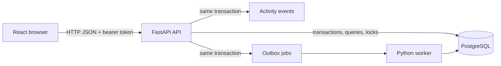
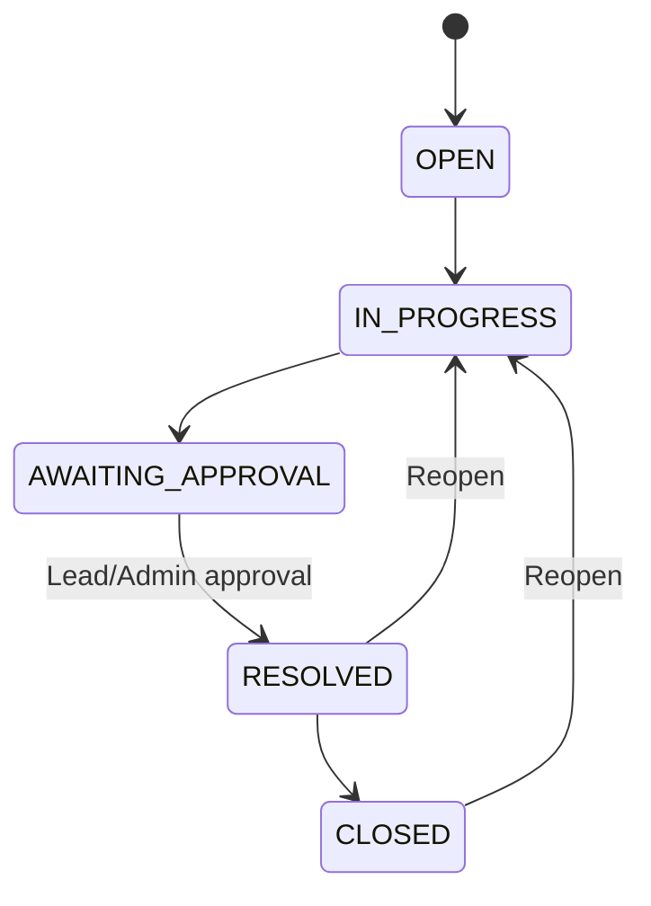

# Operations Under Pressure

An internal operations work-management application for creating, assigning,
tracking, approving, resolving, and auditing work across teams.

The stack is:

- Backend: Python, FastAPI, SQLAlchemy, Alembic
- Frontend: React, TypeScript, TanStack Query
- Database: PostgreSQL
- Async processing: PostgreSQL-backed outbox worker

## Architecture



The browser is not a security boundary. The API authenticates the user,
checks team membership and role, and performs resource-level authorization
before each protected operation.

The **Unassigned urgent** dashboard view is a triage queue: it shows urgent
items that are not closed and have no assignee, so a team member can claim the
next high-priority item that needs attention. The **Awaiting approval** view
shows awaiting items for all authorized team members; only a Lead/Admin can
perform the final approval transition.

## Workflow



## Prerequisites

- Python 3.11+
- Node.js 20+
- Docker Desktop with Docker Compose

## Step 3: start the local database and create the schema

Copy `.env.example` to `.env`, then start PostgreSQL:

```powershell
docker compose up -d postgres
```

Compose exposes PostgreSQL on host port `5433` so it can coexist with an
existing local PostgreSQL installation on port `5432`. The project defaults
and `.env.example` already use `5433`.

Run the initial migration and seed data:

```powershell
alembic upgrade head
cd backend
python -m app.seed
cd ..
```

The backend can then be checked independently:

```powershell
cd backend
python -m venv .venv
.\.venv\Scripts\Activate.ps1
python -m pip install -e ".[dev]"
pytest
uvicorn app.main:app --reload
```

In another terminal:

```powershell
cd frontend
npm install
npm run build
npm run dev
```

## Documentation

- [Engineering decisions](./ENGINEERING_DECISIONS.md)
- [Worker scaffold](./worker/README.md)

## Known limitations

- Docker Compose, PostgreSQL migration/seed, and live critical API checks were
  verified locally. Compose exposes PostgreSQL on host port 5433 because port
  5432 may already be used by a local PostgreSQL service.
- The notification handler validates and processes durable outbox payloads but
  does not call an external email provider.
- Local seeded login should be replaced with organizational SSO in production.
- The dashboard currently focuses on the three required attention views rather
  than full team/user administration. Authorized users can create and edit work
  items from the dashboard and detail screen.
- Real-time WebSockets, file attachments, mobile UI, and email delivery are
  intentionally out of scope.

## Step 6: run the outbox worker

From the repository root, after the database migration and seed:

```powershell
python worker/main.py
```

The worker claims pending jobs with PostgreSQL row locking, retries handler
failures with capped exponential backoff, and marks jobs as completed or
failed after the configured attempt limit.

## Step 7: run the frontend

In another terminal:

```powershell
cd frontend
npm install
npm run dev
```

The frontend provides login, dashboard views, server-side search, item detail,
claim and transition actions, comments, and activity history. It expects the
FastAPI service at `VITE_API_BASE_URL`.

For local development, the API allows requests from the Vite origins
`http://localhost:5173` and `http://127.0.0.1:5173`.

## Seed credentials

All seeded users use:

```text
Password: ChangeMe123!
```

Available accounts:

```text
viewer@example.com
member@example.com
lead@example.com
admin@example.com
```

## Tests

Backend:

```powershell
cd backend
python -m pytest
python -m ruff check app tests
```

Frontend:

```powershell
cd frontend
npm run test
npm run build
```
